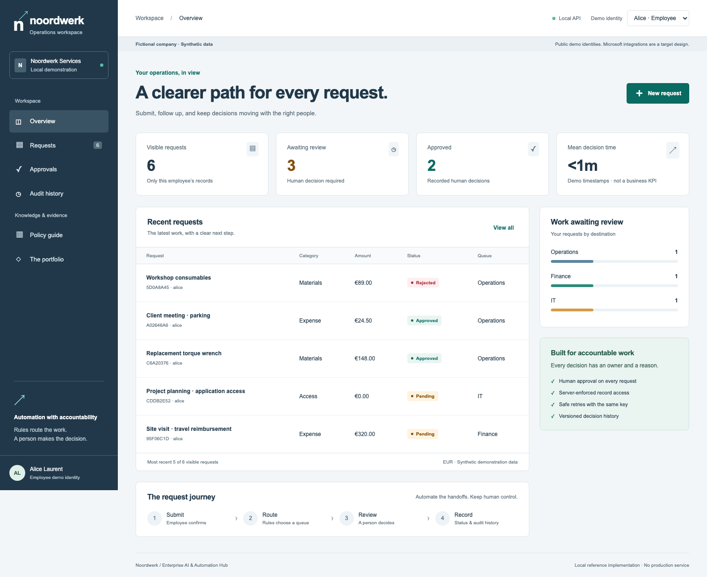
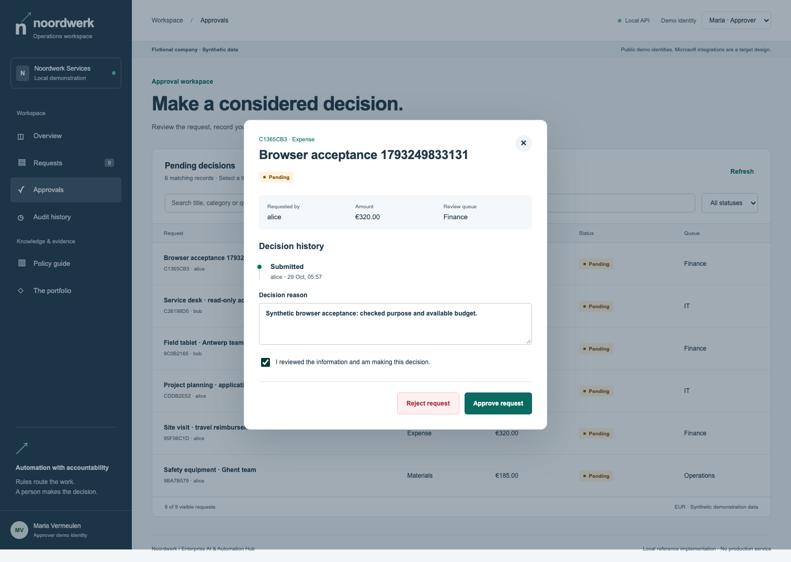
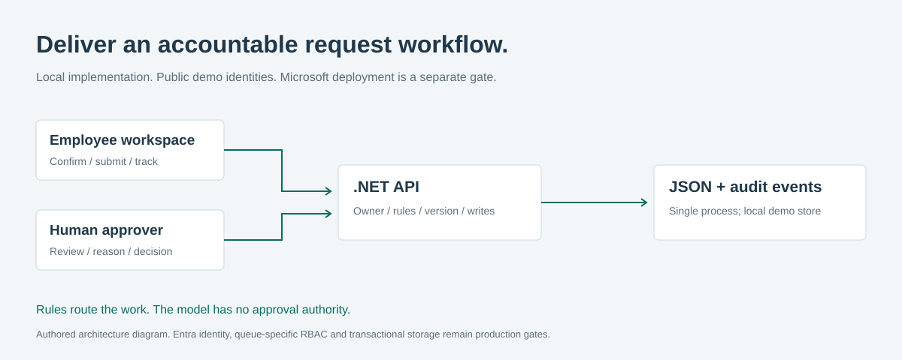

# Noordwerk · Enterprise AI Automation Hub

**A working employee-to-approver workflow: clear routing, human decisions, and inspectable engineering.**



Noordwerk is a **fictional** 140-person technical services company. This independent
portfolio exercise uses synthetic people, records and assumptions. It is not a real
client engagement, a Microsoft product screenshot, or a production service.

## The business problem

Materials, expenses and access requests arrive in email. People chase the right owner;
Finance needs a decision trail; IT needs access boundaries. The solution gives each
request a route and status while keeping the decision with a person.

## Run the demonstration

Prerequisites: .NET 10 SDK, Python 3.11+, Make. No cloud account, paid model or frontend
package installation is required. The server listens only on `127.0.0.1:5088`.

```bash
make verify
dotnet run --project src --configuration Release --no-build
# In a second terminal, from this repository:
python3 scripts/seed_demo.py
# Open http://127.0.0.1:5088/
```

1. As **Alice**, create an expense for €320 and confirm the details. It routes to Finance.
2. Select **Maria · Approver**, open Approvals, inspect the request and record a reason.
3. Approve or reject. Return to Alice and inspect the saved status and audit history.
4. Select **Bob**: Alice's records are inaccessible. Retry the same API submission key:
   it returns the original request; a changed payload conflicts.

The identity switcher chooses **public demo fixtures**, not authenticated users. The
server still derives ownership and permissions from its identity mapping. Data persists
in `data/requests.json`; `HUB_DATA` selects an isolated store. Run one server process.
Seeding is idempotent and never deletes existing records.

## What works

| Capability | Implementation | Boundary |
|---|---|---|
| Employee workspace | Confirmed submission, search/filter, status, detail history | Metadata only; synthetic data |
| Human review | Separate approver, required reason, current version | One demo approver covers all queues |
| Operations view | Visible volume, pending queues, approvals and mean decision time | Calculated from local records; not customer performance |
| Reliable API | Owner-scoped idempotency, concurrency conflict, atomic persistence | One process and a JSON file |
| Browser experience | Responsive layout, keyboard focus, native dialogs, loading/error/empty states | Chromium checked; no full accessibility certification |
| Policy guide | Transparent routing and source links | Rule explanation; does not pretend to call AI |
| Portfolio navigation | Decide / Deliver / Govern within the existing app | No fourth application or public deployment |



## Architecture and technology



ASP.NET Core 10 serves authored HTML, CSS and JavaScript from the same origin. The
existing .NET API remains authoritative for ownership, input validation and state.
Python standard-library clients and HTTP tests keep the default setup small.

Routing is deterministic: access → IT at €0; materials/expenses up to €250 → Operations,
above €250 → Finance. Every request remains pending until a human fixture decides.
There is no reason to ask a model to calculate these rules. The separate agent project
experiments with source-based policy questions and confirmed submission.

[Architecture decisions](docs/architecture.md) · [Process and requirements](docs/process.md)
· [BPMN sources with layout](process/) · [OpenAPI contract](contracts/openapi.json)

## Verification and evidence

`make verify` builds and runs **12 real HTTP tests**, including retries, role separation,
concurrent decisions, persistence and static-UI security headers. It also checks local
Markdown targets and JSON syntax. The optional browser suite tests the real submission
and review journey, record isolation, mobile layout and injected network failure.

```bash
# Optional browser checks, while port 5088 is free:
npm ci --ignore-scripts
npx playwright install chromium
npm run test:browser
# Or set PLAYWRIGHT_MODULE to an existing Playwright index.mjs and run:
# python3 scripts/run_browser.py
```

[Evidence matrix](EVIDENCE.md) · [Executed checks and limitations](VERIFICATION.md)
· [Audit and prioritised backlog](PORTFOLIO_AUDIT.md) · [Before/after report](TRANSFORMATION_REPORT.md)

## Microsoft implementation boundary

[Power Platform handoff](power-platform/README.md) includes the inventory, licensing
questions, deployment-settings example and acceptance gates. The [detailed build
specification](docs/power-platform-build-guide.md) covers Power Apps, Power Automate,
Dataverse, Copilot Studio, Teams and SharePoint.

These are **documented designs pending external validation**, not Noordwerk solution
exports. Existing Brevan/construction labs are separate projects with separate evidence.
No Entra login, live connector, tenant deployment or applied DLP policy is claimed here.

## Security, value and next steps

Known demo tokens are not production authentication. A JSON audit can be edited by a
file administrator. Before tenant exposure: validated Entra identity, queue-specific
permissions, transactional storage, protected audit, retention and recovery testing.
Documents, extraction, notification delivery and scheduled escalation are deferred.
No payments, access grants or autonomous approvals are executed.

The companion business case is an assumption model: **−€7,695 in year one with an
adoption ramp**, not measured savings. It recommends a bounded pilot rather than an
unqualified rollout. See [security](SECURITY.md) and the [operational runbook](docs/runbook.md).

## One client, three complementary cases

| Stage | Project | What it demonstrates |
|---|---|---|
| Decide | [Consulting Playbook](https://github.com/phlppgdfry/ai-transformation-consulting-playbook) | Discovery, investment decision, roadmap and adoption |
| Deliver | This Hub | Working process and accountable human review |
| Govern | [Agent Governance](https://github.com/phlppgdfry/enterprise-ai-agent-governance) | Real model experiment, source boundaries and honest evaluations |

[Interview walkthroughs](docs/interview-guide.md) · [Portfolio strategy](docs/portfolio-strategy.md)
· [MIT license](LICENSE)
