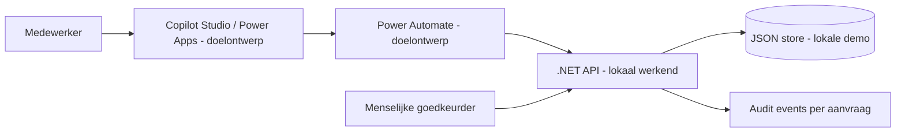

# Architectuur en beslissingen

Fictieve klant: Noordwerk, een middelgrote technische dienstverlener. De drie
repositories gebruiken dezelfde aanvraagcategorieën, grens van 250 EUR en rollen.

De lokale demonstratie gebruikt Python-clients in plaats van de drie Microsoft
producten. De API is de autoriteit voor validatie, eigenaar en status. Een AI-agent
kan een aanvraag voorbereiden en na bevestiging indienen, maar krijgt geen
goedkeuringsactie. Een retry met dezelfde sleutel en payload levert hetzelfde ID;
een andere payload bij dezelfde sleutel geeft 409. Sleutels zijn per eigenaar.

## ADR-001: geen model voor procesregels

Categorie en bedrag bepalen de wachtrij. Dit is deterministische businesslogica,
geen taak voor een taalmodel. AI wordt pas interessant bij kennisvragen of het
voorstellen van categorieën. De mens bevestigt alle voorgestelde invoer.

## ADR-002: expliciete state machine

`pending → approved | rejected`. Alleen rol approver kan beslissen, met verplichte
reden en huidige versie. Een concurrerende of herhaalde beslissing geeft 409.
Een medewerker ziet alleen eigen records; een ontoegankelijk ID geeft 404.
De rollen en gebruikers komen lokaal uit vaste testidentiteiten, nooit uit een
vrij invulbaar rolveld. Eén approver behandelt alle drie wachtrijen in de demo.

## ADR-003: eenvoudige persistente referentie-implementatie

Eén proces, een lock, schrijven naar tijdelijk bestand, flush en atomair hernoemen.
De nieuwe lijst wordt pas na geslaagde opslag actief. Corrupte JSON blokkeert
startup. Dit ondersteunt herstart en gelijktijdige requests binnen één proces,
geen meerdere replica's, database-transacties, backups of audit-integriteit tegen
een beheerder die het bestand kan wijzigen. De JSON-store is geen Dataverse.

## Naar productie

Vervang demotokens door gevalideerde Entra-tokens (issuer, audience, scopes,
tenant, expiry). Bepaal eigenaar uit de gevalideerde identiteit. Geef IT,
Operations en Finance gescheiden rechten; dwing die af in de API en Dataverse.
Gebruik Dataverse/SQL met transacties, unieke idempotency-index, versiecontrole,
versleuteling, backup/restore en een extern auditlog. Voeg rate limiting,
retentiebeleid, telemetry zonder documentinhoud en alerting toe. Test expliciet
delegatie, tenantisolatie, connectorfalen en herstel vóór publicatie.
