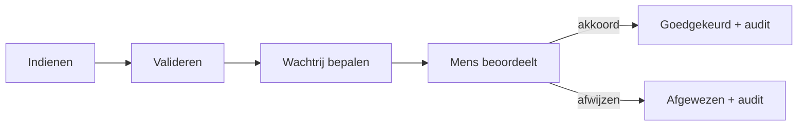

# Huidig en verbeterd proces

De observaties hieronder zijn scenario-aannames, geen workshopverslag van een klant.

| Stap | As-is | To-be | Acceptatie |
|---|---|---|---|
| Indienen | E-mail zonder vaste gegevens | Gevalideerd formulier en expliciete bevestiging | Verkeerd bedrag geeft 400 |
| Routeren | Medewerker zoekt goedkeurder | Access → IT, >250 EUR → Finance, anders Operations | Grens 250/250.01 getest |
| Herhalen | Dubbele mail wordt dubbel werk | Sleutel per eigenaar en payload | Concurrente retries maken één ID |
| Beslissen | Akkoord raakt zoek in e-mail | Mens, reden, versie en audit-event | Medewerker krijgt 403 |
| Opvolgen | Navraag per telefoon | Eigen aanvraagstatus | Andere medewerker krijgt 404 |

## BPMN-bestanden

[As-is](../process/as-is.bpmn) en [to-be](../process/to-be.bpmn) bevatten semantische
BPMN 2.0-processen. Ze zijn niet uitvoerbaar; BPMN DI-coördinaten maken de modellen direct zichtbaar
in een compatibele editor. De lay-out is lokaal als XML gecontroleerd; een externe BPMN-editor is nog niet getest. Het to-be-model abstraheert de routering
als één service task; de tabel hierboven legt de beslisregels vast.

## Functionele scope

FR01 medewerker kan indienen; FR02 medewerker ziet eigen status; FR03 menselijke
goedkeurder beslist; FR04 retries zijn veilig; FR05 audit overleeft herstart.
Automatische boeking, ERP, betalingen en documentopslag vallen buiten de lokale scope.
De SLA-afspraak is controle elke werkdag en escalatie na twee werkdagen; hiervoor
is nog een scheduler/flow nodig. Dwing de afspraak niet af met een fictieve testscore.
